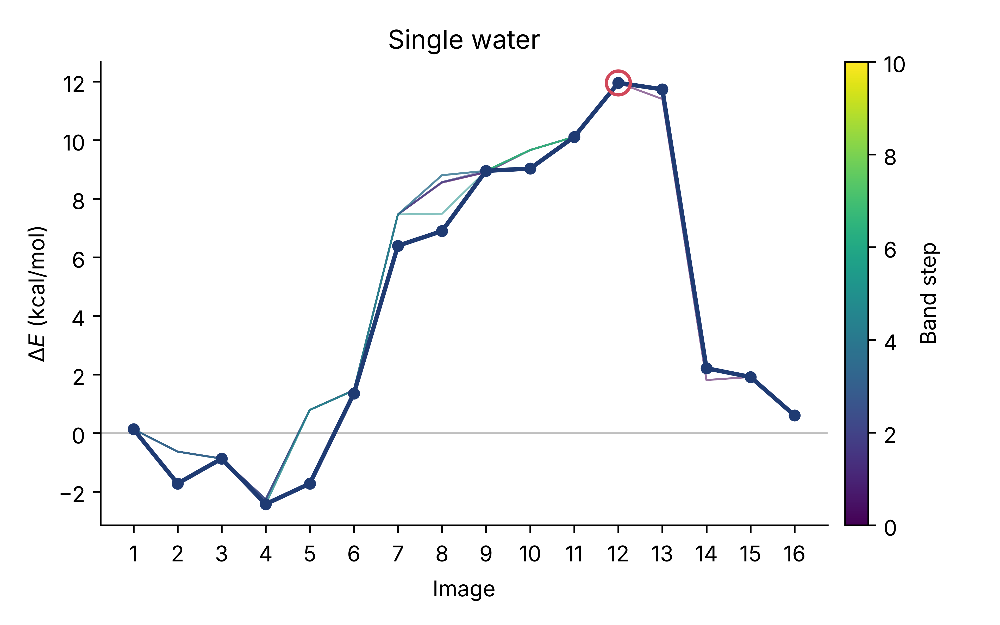
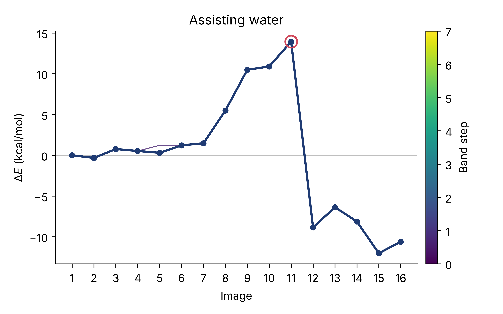
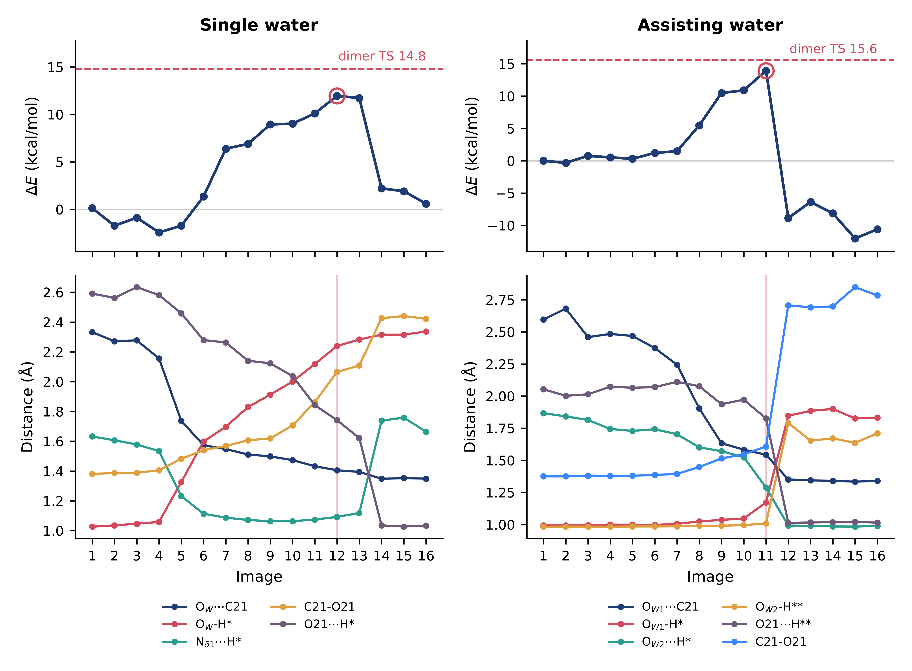

 
<h2>
<b> III - Minimum energy path with the CI-NEB method </b>
</h2>

 

<pre style="color: white; background-color: black;">
&GLOBAL
    PROJECT     CI_NEB
    RUN_TYPE    BAND
...
</pre>

---

 

In this section the images built in Section II are relaxed together into a minimum energy path (MEP) between the reactant and the product, with the climbing image nudged elastic band method (CI-NEB). The inputs are files/single_water/MEP.inp and files/assisting_water/MEP.inp; their &FORCE_EVAL is the one of Section I, plus the CVs of Section II.

<h3>
 <b> Band settings </b>
</h3>

 

- 
The band is set up in the &MOTION/&BAND section. BAND_TYPE CI-NEB switches on the climbing image, and POT_TYPE ME asks for a minimum energy path. The replicas run in parallel, so the number of MPI tasks must be NPROC_REP × NUMBER_OF_REPLICA (here 64 × 16 = 1024). K_SPRING is the spring constant between neighbouring images (in Hartree bohr−2). ROTATE_FRAMES and ALIGN_FRAMES are switched off: with most of the system fixed, the images must not be rotated or translated onto each other.

<pre style="color: white; background-color: black;">
&MOTION
    &BAND
        BAND_TYPE          CI-NEB
        NUMBER_OF_REPLICA  16
        NPROC_REP          64
        K_SPRING           0.05
        POT_TYPE           ME
        USE_COLVARS        .TRUE.
        ROTATE_FRAMES      F
        ALIGN_FRAMES       F
        ...
</pre>

 

- 
USE_COLVARS .TRUE. projects the band onto the space of the CVs defined in &FORCE_EVAL/&SUBSYS (Section II): the band moves along the CVs, and every image is relaxed in the remaining degrees of freedom. The CVs must therefore have a &COLLECTIVE section with a &RESTRAINT in &MOTION/&CONSTRAINT (without TARGET: CP2K sets the target of each image itself). The relaxation of each image is a constrained geometry optimization, controlled by the &MOTION/&GEO_OPT section of the input (the same criteria as in Section I). This is why each replica output, CI_NEB-BAND&#42;.out, contains a "STARTING GEOMETRY OPTIMIZATION" block at every band step.

<pre style="color: white; background-color: black;">
&MOTION
    ...
    &GEO_OPT
        OPTIMIZER LBFGS
        MAX_ITER  5000
        MAX_DR    1.8E-03
        RMS_DR    1.2E-03
        MAX_FORCE 4.5E-04
        RMS_FORCE 3.0E-04
    &END GEO_OPT
    &CONSTRAINT
        &COLLECTIVE
            COLVAR         1
            INTERMOLECULAR TRUE
            &RESTRAINT
                K [angstrom^-2*kcalmol] 25.0
            &END RESTRAINT
        &END COLLECTIVE
        &COLLECTIVE
            COLVAR         2
            ...
        &FIXED_ATOMS
            @INCLUDE fixed_atoms.inc
        &END FIXED_ATOMS
    &END CONSTRAINT
    ...
</pre>

 

- 
NSTEPS_IT is the number of improved-tangent NEB steps run before the climbing image is switched on, so the band can settle before its highest image starts climbing. The band is optimized with DIIS (with steepest-descent steps where DIIS is not safe, as the output shows). OPTIMIZE_END_POINTS F keeps the first and last images as they are, which is what you want when they are already optimized minima.

<pre style="color: white; background-color: black;">
&MOTION
    &BAND
        ...
        &CI_NEB
            NSTEPS_IT 5
        &END CI_NEB
        &OPTIMIZE_BAND
            OPT_TYPE            DIIS
            OPTIMIZE_END_POINTS F
            &DIIS
                MAX_STEPS 500
            &END DIIS
        &END OPTIMIZE_BAND
        &CONVERGENCE_CONTROL
            MAX_FORCE 0.030
            RMS_FORCE 0.050
            MAX_DR    0.01
            RMS_DR    0.02
        &END CONVERGENCE_CONTROL
        &PROGRAM_RUN_INFO
            INITIAL_CONFIGURATION_INFO
        &END PROGRAM_RUN_INFO
        &CONVERGENCE_INFO
        &END CONVERGENCE_INFO
        ...
</pre>

 

- 
The starting images are given in one &REPLICA section each, as XYZ files (the &TOPOLOGY section also reads REPLICA_1.xyz, as COORD_FILE_FORMAT XYZ). If there are fewer &REPLICA sections than NUMBER_OF_REPLICA, CP2K builds the missing images by interpolating between the given ones; in the assisting-water input three of the scan structures are left out (commented) and the band is completed by CP2K.

<pre style="color: white; background-color: black;">
&MOTION
    &BAND
        ...
        &REPLICA
            COORD_FILE_NAME REPLICA_1.xyz
        &END REPLICA
        &REPLICA
            COORD_FILE_NAME REPLICA_2.xyz
        &END REPLICA
        ...
        &REPLICA
            COORD_FILE_NAME REPLICA_16.xyz
        &END REPLICA
    &END BAND
</pre>

 

---

 

<h3>
 <b> Following the band </b>
</h3>

 

- 
At every band step the main output prints the distance between neighbouring images (DISTANCES REP) and the energy of each image (ENERGIES, in Hartree). Here is the last step of the single-water run:

<pre style="color: white; background-color: black;">
 BAND TYPE                     =                                          CI-NEB
 BAND TYPE OPTIMIZATION        =                                            DIIS
 STEP NUMBER                   =                                              10
 NUMBER OF NEB REPLICA         =                                              16
 DISTANCES REP =        0.485175        0.322466        0.305915        0.354815
                        0.481636        0.625117        0.706824        0.628566
                        0.661989        0.545552        0.657874        0.618970
                        0.671647        0.397725        0.266441
 ENERGIES [au] =    -1164.567514    -1164.570470    -1164.569119    -1164.571591
                    -1164.570475    -1164.565578    -1164.557537    -1164.556741
                    -1164.553464    -1164.553341    -1164.551618    -1164.548673
                    -1164.549033    -1164.564202    -1164.564677    -1164.566768
 BAND TOTAL ENERGY [au]        =                           -18632.96828224120691
</pre>

 

- 
The same numbers are written, one line per band step, to the CI_NEB-1.ener file. The cp2k_band_evolution.py script reads it, tabulates the profile of the last step (or of any step, with <code>--step</code>) relative to the reactant, flags the highest image and the largest gap between images, and plots the profile at every step, which shows whether the band is still moving:

<pre style="color: white; background-color: black;">
./cp2k_band_evolution.py CI_NEB-1.ener --ref-out geo_opt.out --plot band_evolution_single.png --title "Single water"
# CI_NEB-1.ener: 16 replicas, 11 band steps (step 0 to 10)
# profile of step 10; reference: geo_opt.out
IMAGE                E/Ha     dE/kcal/mol   d(i,i+1)/a.u.
    1     -1164.567514353            0.13          0.4852
    2     -1164.570469736           -1.72          0.3225
    3     -1164.569118752           -0.88          0.3059
    4     -1164.571591120           -2.43          0.3548
    5     -1164.570475001           -1.73          0.4816
    6     -1164.565578427            1.35          0.6251
    7     -1164.557537499            6.39          0.7068
    8     -1164.556740688            6.89          0.6286
    9     -1164.553463537            8.95          0.6620
   10     -1164.553340790            9.02          0.5456
   11     -1164.551617515           10.11          0.6579
   12     -1164.548673123           11.95          0.6190
   13     -1164.549033460           11.73          0.6716
   14     -1164.564201730            2.21          0.3977
   15     -1164.564677091            1.91          0.2664
   16     -1164.566768188            0.60
# highest interior image: 12 (11.95 kcal/mol)
# largest gap between adjacent images: 7-8 (0.707 a.u.; mean 0.515 a.u.)
# largest energy change of a replica since the previous step (9): 0.001 kcal/mol
# figure saved to band_evolution_single.png (600 dpi)
</pre>

  <figure><figcaption><b>Single water.</b> Profile at each of the 11 band steps (colour) and at the last one (dark blue), relative to the optimized reactant.</figcaption></figure>
  <figure><figcaption><b>Assisting water.</b> The same for the 8 steps of the assisting-water run.</figcaption></figure>

- 
Look at the distances between images as well as at the energies: they should be fairly even along the band, and an unusually large gap, or a large energy step between two images, marks a part of the path that is poorly described. In both runs shown here the profile changed very little over the last band steps. The highest image (12 for single water, 11 for assisting water) is the natural TS guess for the next sections.

 

- 
The total energy of each replica, and its split into a QM part (QM energy including the QM/MM electrostatic interaction, the "Total energy" of the SCF) and an MM part, can be tabulated from the replica outputs with cp2k_energy_analysis.py. The <code>--plot</code> option saves (and shows) a figure of the energy differences:

<pre style="color: white; background-color: black;">
./cp2k_energy_analysis.py CI_NEB-BAND*.out --ref geo_opt.out --plot neb_energy.png --xlabel Image
# reference: geo_opt.out
OUTPUT              N_FE              E_T/Ha     E_QM+QM/MM/Ha           E_MM/Ha   dE_T/kcal/mol  dE_QM+QM/MM/kcal/mol   dE_MM/kcal/mol
---------------------------------------------------------------------------------------------------------------------------------------
CI_NEB-BAND01.out    494     -1164.567514353     -850.74326506     -313.82424929            0.13                 26.42           -26.29
CI_NEB-BAND02.out    651     -1164.570469736     -850.96669326     -313.60377647           -1.72               -113.79           112.06
CI_NEB-BAND03.out    726     -1164.569118752     -850.87145031     -313.69766844           -0.88                -54.02            53.15
CI_NEB-BAND04.out    783     -1164.571591120     -850.78804635     -313.78354477           -2.43                 -1.68            -0.74
CI_NEB-BAND05.out    701     -1164.570475001     -850.77099222     -313.79948278           -1.73                  9.02           -10.74
CI_NEB-BAND06.out    741     -1164.565578427     -850.78058573     -313.78499270            1.35                  3.00            -1.65
CI_NEB-BAND07.out    665     -1164.557537499     -850.79755141     -313.75998609            6.39                 -7.65            14.04
CI_NEB-BAND08.out    822     -1164.556740688     -850.55908101     -313.99765968            6.89                141.99          -135.10
CI_NEB-BAND09.out    595     -1164.553463537     -850.87775743     -313.67570611            8.95                -57.98            66.93
CI_NEB-BAND10.out    671     -1164.553340790     -850.81778510     -313.73555569            9.02                -20.35            29.37
CI_NEB-BAND11.out    592     -1164.551617515     -850.68611568     -313.86550183           10.11                 62.28           -52.17
CI_NEB-BAND12.out    482     -1164.548673123     -850.58963411     -313.95903901           11.95                122.82          -110.87
CI_NEB-BAND13.out    674     -1164.549033460     -850.58244934     -313.96658412           11.73                127.33          -115.60
CI_NEB-BAND14.out    857     -1164.564201730     -850.49121408     -314.07298765            2.21                184.58          -182.37
CI_NEB-BAND15.out    575     -1164.564677091     -850.52895279     -314.03572430            1.91                160.90          -158.99
CI_NEB-BAND16.out    582     -1164.566768188     -850.50112168     -314.06564651            0.60                178.36          -177.76
---------------------------------------------------------------------------------------------------------------------------------------
# highest total energy: CI_NEB-BAND12.out (11.95 kcal/mol above the reference)
</pre>

 

- 
N_FE is the number of force evaluations in each output. With electrostatic embedding and GPW, the split between the two parts is not a robust quantity: during a single run it jumps by tens of kcal/mol while ET hardly changes (follow the "Total energy" and "Total FORCE_EVAL" lines of any CI_NEB-BAND&#42;.out), and the two columns compensate each other almost exactly. Here only ET is interpreted; the split is more informative with mechanical embedding or semi-empirical QM methods.

 

---

 

<h3>
 <b> Exploring the band </b>
</h3>

 

The panel below shows the final band of each pathway: the energy profile, relative to the optimized reactant, next to the QM region of the selected image. Press <b>Play</b> to go through the images from the reactant to the product, click a point (or use the slider, or the arrow keys) to show one image, and drag, scroll or pinch the structure to rotate and zoom it. The structures are drawn in ball-and-stick with VMD-like colours (C cyan, O red, N blue, H white, Ca2+ green), showing the residues around the reacting atoms (tick <b>Whole QM region</b> to see all of it); the dashed yellow lines are the bonds that form or break, when the atoms are not bonded, and the distances of all of them are listed below the panel (tick <b>Distances</b> to label them in the structure). The dashed red line is the energy of the saddle point refined with the dimer method in Section V.

<noscript>The interactive panel needs JavaScript; the figure below shows the same data.</noscript>

The structures are the QM regions of the 16 final images (files neb_single_water_traj.pdb and neb_assisting_water_traj.pdb in assets/data). The 3D view uses <a href="https://3dmol.csb.pitt.edu/" target="_blank">3Dmol.js</a>.

<figure class="fig"><figcaption><b>Energy and geometry along the bands.</b> Top: energy of each image relative to the optimized reactant, with the highest image circled and the energy of the dimer-refined TS (dashed). Bottom: distances that change during the reaction (H&#42; is the proton released by the attacking water, H&#42;&#42; the proton of W2 that reaches O21).</figcaption></figure>

 

- 
<b>Single water.</b> The attack of the water on C21 and the transfer of its proton to His47 happen together (images 4 to 6: OW···C21 drops from 2.16 to 1.57 Å while Nδ1···H&#42; drops from 1.53 to 1.11 Å), giving a tetrahedral intermediate-like structure that is not a minimum: the energy keeps rising while the C21-O21 bond stretches (1.54 to 2.11 Å, images 6 to 13). Between images 13 and 14 His47 hands H&#42; to O21 (Nδ1···H&#42; from 1.12 to 1.74 Å, O21···H&#42; from 1.62 to 1.03 Å) and the energy drops by 9.5 kcal/mol. The reaction is concerted but very asynchronous, with the TS in the breakdown of the tetrahedral structure.

- 
<b>Assisting water.</b> W1 attacks C21 (2.24 to 1.54 Å, images 7 to 11) while H&#42; moves from W1 to W2, which at image 11 holds three protons (a hydronium-like W2, OW2···H&#42; 1.29 Å). Between images 11 and 12 the C21-O21 bond breaks (1.61 to 2.71 Å), W2 gives H&#42;&#42; to O21 and the energy falls by 22.8 kcal/mol. His47 is not protonated along this path.

- 
In both bands the largest change happens between two images, so the climbing image cannot sit exactly on the saddle point and the band energy underestimates the barrier: the dimer method (Section V) places the single-water TS 2.8 kcal/mol above image 12, with H&#42; halfway between Nδ1 and O21 (1.15 and 1.51 Å), i.e. between images 13 and 14. Adding images in that region, or rerunning the band with images interpolated there, improves the description of the path, but locating the saddle point exactly is the job of the dimer method.

- 
Images 2 to 5 of the single-water band lie up to 2.4 kcal/mol below the optimized reactant (the first image, which is not optimized by the band, is 0.1 kcal/mol above it). The reactant basin is flat, and the band finds slightly lower structures in it. This is worth checking in your own systems: re-optimizing the reactant from the lowest image of the band would give a lower reference, and correspondingly higher barriers.

 
