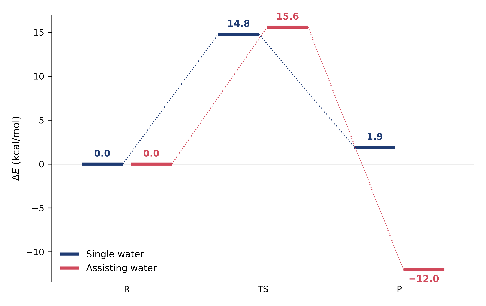

 
<h2>
<b> V - TS optimization with the dimer method </b>
</h2>

 

<pre style="color: white; background-color: black;">
&GLOBAL
    PROJECT     DIMER
    RUN_TYPE    GEO_OPT
...
</pre>

---

 

The dimer method follows the lowest-curvature direction of the potential energy surface uphill from a TS guess until it reaches a first-order saddle point, using only gradients. Two images (the "dimer", separated by a small distance) are rotated around their midpoint to find the direction of most negative curvature, and the midpoint is then moved up along that direction and down along all the others. The inputs are files/single_water/dimer.inp and files/assisting_water/dimer.inp; they read the TS guess (ts.pdb or ts.xyz) and the initial dimer direction of Section IV (vector.inc).

<h3>
 <b> Dimer settings </b>
</h3>

 

- 
A TS search is a geometry optimization of TYPE TRANSITION_STATE. The translation of the dimer uses conjugate gradients with a two-point line search, and the same convergence criteria as the optimizations of minima.

<pre style="color: white; background-color: black;">
&MOTION
    &GEO_OPT
        TYPE      TRANSITION_STATE
        OPTIMIZER CG
        MAX_ITER  5000
        MAX_DR    1.8E-03
        RMS_DR    1.2E-03
        MAX_FORCE 4.5E-04
        RMS_FORCE 3.0E-04
        &CG
            MAX_STEEP_STEPS 10
            &LINE_SEARCH
                TYPE 2PNT
                &2PNT
                &END 2PNT
            &END LINE_SEARCH
        &END CG
        ...
</pre>

 

- 
METHOD DIMER is chosen in &TRANSITION_STATE. DR is the distance between the midpoint and each image of the dimer: small enough for the finite-difference curvature to be accurate, large enough to stay above the numerical noise of the forces (0.01 Å is a common choice, but it may need tuning). ANGLE_TOLERANCE is the convergence criterion of the rotation, and INTERPOLATE_GRADIENT T interpolates the gradient of the rotated dimer instead of computing it whenever possible, which saves force evaluations.

<pre style="color: white; background-color: black;">
&MOTION
    &GEO_OPT
        ...
        &TRANSITION_STATE
            METHOD DIMER
            &DIMER
                DR [angstrom]         0.01
                ANGLE_TOLERANCE [deg] 1.5
                INTERPOLATE_GRADIENT  T
                ...
</pre>

 

- 
The initial direction of the dimer is read from vector.inc (Section IV) in &DIMER_VECTOR; without it the dimer starts from a random direction and has to rotate much more. The rotation itself is optimized with conjugate gradients in &ROT_OPT.

<pre style="color: white; background-color: black;">
&MOTION
    &GEO_OPT
        ...
        &TRANSITION_STATE
            ...
            &DIMER
                ...
                &DIMER_VECTOR
                    @INCLUDE vector.inc
                &END DIMER_VECTOR
                &ROT_OPT
                    OPTIMIZER CG
                    MAX_ITER  500
                    &CG
                        MAX_STEEP_STEPS 10
                        &LINE_SEARCH
                            TYPE 2PNT
                            &2PNT
                            &END 2PNT
                        &END LINE_SEARCH
                    &END CG
                &END ROT_OPT
            &END DIMER
        &END TRANSITION_STATE
    &END GEO_OPT
    ...
</pre>

 

---

 

<h3>
 <b> Following the dimer </b>
</h3>

 

- 
After each rotation the output prints the curvature along the dimer ("Local Curvature"), which must be negative near a saddle point, and after each translation the usual convergence block. Here are the last steps of the assisting-water search:

<pre style="color: white; background-color: black;">
  Local Curvature            =        -0.0187782935
  ...
 --------  Informations at step =    87 ------------
  Optimization Method        =                   CG
  Total Energy               =         0.0004918721
  Real energy change         =         0.0004891725
  Decrease in energy         =                   NO
  Used time                  =              191.848

  Convergence check :
  Max. step size             =         0.0014446619
  Conv. limit for step size  =         0.0018000000
  Convergence in step size   =                  YES
  RMS step size              =         0.0000157236
  Conv. limit for RMS step   =         0.0012000000
  Convergence in RMS step    =                  YES
  Max. gradient              =         0.0003894540
  Conv. limit for gradients  =         0.0004500000
  Conv. in gradients         =                  YES
  RMS gradient               =         0.0000042388
  Conv. limit for RMS grad.  =         0.0003000000
  Conv. in RMS gradients     =                  YES
 ---------------------------------------------------

 *******************************************************************************
 ***                    GEOMETRY OPTIMIZATION COMPLETED                      ***
 *******************************************************************************
</pre>

 

- 
The two searches behaved quite differently. The assisting-water search started from image 11 of the band (13.9 kcal/mol above the reactant), with a negative curvature from the first step, and converged in 87 steps, 1.6 kcal/mol higher. In the single-water search the initial dimer direction, obtained on another structure, had a positive curvature on the starting geometry (16.6 kcal/mol above the reactant): the curvature along the dimer stayed positive for the first 15 steps, while the energy went up by about 30 kcal/mol, until the dimer turned into a direction of negative curvature (step 16) and came back down; it converged in 146 steps, 1.8 kcal/mol below the starting point. A dimer vector computed on the same structure where the search starts avoids such detours.

- 
The final energy is the one CP2K re-evaluates at the converged geometry, right after "GEOMETRY OPTIMIZATION COMPLETED" (the force evaluations that follow belong to the last rotation of the dimer). cp2k_energy_analysis.py takes that energy for optimizations and dimer runs:

<pre style="color: white; background-color: black;">
./cp2k_energy_analysis.py geo_opt.out dimer.out CI_NEB-BAND15.out --sort none --ref geo_opt.out    # single water
OUTPUT              N_FE              E_T/Ha     E_QM+QM/MM/Ha           E_MM/Ha   dE_T/kcal/mol  dE_QM+QM/MM/kcal/mol   dE_MM/kcal/mol
geo_opt.out           85     -1164.567722277     -850.78536159     -313.78236068            0.00                  0.00             0.00
dimer.out            862     -1164.544176498     -850.47001462     -314.07416188           14.78                197.88          -183.11
CI_NEB-BAND15.out    575     -1164.564677091     -850.52895279     -314.03572430            1.91                160.90          -158.99

./cp2k_energy_analysis.py geo_opt.out dimer.out CI_NEB-BAND15.out --sort none --ref geo_opt.out    # assisting water
OUTPUT              N_FE              E_T/Ha     E_QM+QM/MM/Ha           E_MM/Ha   dE_T/kcal/mol  dE_QM+QM/MM/kcal/mol   dE_MM/kcal/mol
geo_opt.out           23     -1180.365786327     -869.37290226     -310.99288406            0.00                  0.00             0.00
dimer.out            526     -1180.340948309     -869.77948034     -310.56146797           15.59               -255.13           270.72
CI_NEB-BAND15.out    490     -1180.384942647     -869.25464353     -311.13029911          -12.02                 74.21           -86.23
</pre>

 

---

 

<h3>
 <b> Results </b>
</h3>

 

The reactant (R) is the optimized structure of Section I, the TS the converged dimer, and the product (P) the lowest-energy image on the product side of the band (image 15). The three structures of each pathway are in <a href="https://github.com/arvpinto/enzyme_neb_cp2k/tree/main/files" target="_blank">files/</a> (R.pdb.gz, TS.pdb.gz and P.pdb.gz).

| | Single water | Assisting water |
|---|---|---|
| E(R) / Ha | −1164.567722 | −1180.365786 |
| E(TS) / Ha | −1164.544176 | −1180.340948 |
| E(P) / Ha (band image 15) | −1164.564677 | −1180.384943 |
| ΔE‡ / kcal mol−1 | 14.8 | 15.6 |
| ΔEr / kcal mol−1 | 1.9 | −12.0 |
| Imaginary frequency of the TS / cm−1 | 116.5i | 254.7i |
| Dimer steps | 146 | 87 |

 

<figure class="fig"><figcaption><b>QM/MM (PBE/AMBER) energies</b> of the reactant, transition state (dimer) and product (band image 15) of both pathways, relative to the respective reactant.</figcaption></figure>

 

| Distance at the TS / Å | Single water | Assisting water |
|---|---|---|
| OW···C21 (OW1···C21) | 1.39 | 1.46 |
| C21-O21 | 2.11 | 1.73 |
| OW-H&#42; (OW1-H&#42;) | 2.29 | 1.53 |
| Nδ1(His47)···H&#42; | 1.15 | |
| OW2···H&#42; | | 1.06 |
| OW2-H&#42;&#42; | | 1.04 |
| O21···H&#42; (O21···H&#42;&#42;) | 1.51 | 1.69 |

 

- 
With this setup the single-water pathway has the lower barrier (14.8 against 15.6 kcal/mol), the same values reported for the adiabatic QM/MM calculations in <a href="https://doi.org/10.1039/d4sc02315c" target="_blank">Chem. Sci. 2024, 15, 9793</a>, where they are complemented with QM/MM MD umbrella sampling simulations.

- 
Both TSs are late, in the breakdown of the tetrahedral structure formed by the attack of the water: the nucleophile is already bonded to C21 (1.39 and 1.46 Å) and the C21-O21 bond is broken or breaking. In the single-water TS the proton is being transferred from His47 to the leaving O21; in the assisting-water TS W2 holds three protons (a hydronium-like species) and is transferring one of them to O21. The imaginary modes of Section IV show exactly these motions.

 

---

 

<h3>
 <b> What to do next </b>
</h3>

 

- 
Check the saddle point with a vibrational analysis (Section IV): one imaginary frequency, with a mode that corresponds to the reaction.

- 
Make sure that the TS connects the intended minima: displace it slightly along both directions of the imaginary mode (e.g. the first frames of the file written by cp2k_vib_analysis.py <code>--animate</code>, or a larger <code>--amplitude</code>) and optimize both structures without restraints. They should fall into the reactant and the product basins.

- 
Optimize the product as well (here P is a band image), and check the minima for imaginary frequencies.

- 
Refine the energies with a larger basis set, other functionals or a larger QM region, and, since a single reaction path in a flexible enzyme can be misleading, repeat the search from other starting structures or move on to free energies (e.g. QM/MM MD umbrella sampling, the next tutorial of the series).

 
